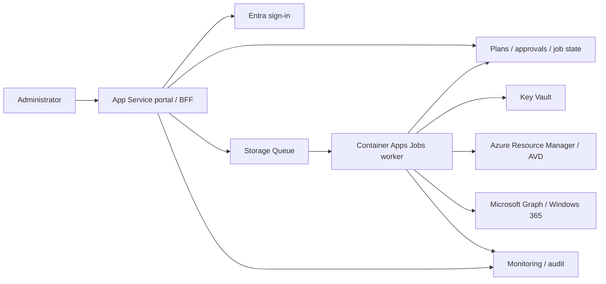

# V2 Project Brief: Desktop Deployment Portal

Status: SUPERSEDED HISTORICAL DRAFT. The [agreed self-hosted design](README.md), its eight ADRs and linked delivery phases replace this brief. Content below records earlier alternatives only and must not be used as implementation requirements.
Date: 2026-10-11.
Working name: Desktop Deployment Portal.

## Purpose

Build an Azure-hosted web portal that guides authorized administrators through deploying Azure Virtual Desktop (AVD) and provisioning Windows 365 Enterprise Cloud PCs. Replace repeated script prompts with validated configuration, explicit plans and approvals, durable background jobs, and clear completion reports.

Keep Bicep authoritative for Azure infrastructure and retain a CLI that uses the same configuration and deployment engine. Microsoft Graph handles supported Windows 365 operations. One experience must not imply identical provisioning mechanics for both products.

The [agreed V2 design](README.md) takes precedence. In particular, self-hosted distribution, SWA Standard, delegated discovery/preview and scoped UAMI execution replace the tentative architecture below.

## Outcomes

- An administrator can configure, validate, review and submit a supported deployment without manually coordinating several scripts.
- Accepted jobs survive browser closure and can be investigated or safely resumed after a worker failure.
- Every write is attributable to a requester, approval and execution identity, with its target scope recorded.
- AVD and Windows 365 share navigation, configuration handling, approval and job tracking while retaining distinct provider logic.
- The current root-level deployment workflow remains usable throughout V2 development.

## Audience And Boundaries

Primary users are Azure/desktop administrators deploying into their organization's environment. Tenant administrators perform privileged onboarding and consent; reviewers approve deployment plans; support operators inspect sanitized job status.

Recommended initial boundary: one Entra tenant per installation, with explicitly authorized subscriptions in that tenant. A customer-hosted instance is supported by the design direction; a central MSP/multi-tenant service is not part of the initial release. Confirm this boundary before implementation.

The portal is an administration tool, not a storefront, end-user desktop client or arbitrary script-execution service. Windows 365-only workflows need tenant authorization but do not inherently require a customer Azure subscription when using Microsoft-hosted networking; hosting the portal still requires one.

## Scope

### Initial V2 Release

| Area | Included |
| --- | --- |
| Access | Entra sign-in, tenant restriction, application roles and server-side target authorization |
| Configuration | Guided product-specific forms, reviewed profiles, server validation, versioned non-secret import/export |
| Discovery | Authorized subscriptions/resource groups, existing networks/groups, supported images and provider-specific prerequisites |
| Planning | ARM what-if for Azure resources, desired/current comparison for Graph changes, blockers and manual tasks |
| Approval | Approval bound to an immutable plan, artifact version, target scope and expiry |
| Execution | Durable queued jobs, isolated workers, stage tracking, bounded retries and target locks |
| AVD | Platform and session hosts, access assignments, profile storage/private DNS within the approved profile |
| Windows 365 | Enterprise provisioning policies and group assignments, license verification and Cloud PC status |
| Operations | Job history, sanitized diagnostics, partial-failure reports and controlled retry/resume |
| Automation | CLI and UI sharing configuration contracts and provider orchestration |

Deliver AVD first as a usable milestone. Windows 365 Enterprise is required for the initial V2 release, but follows in a separate provider milestone rather than blocking the first AVD pilot.

### Excluded Initially

- Windows Forms application or domain-connected agent; document Windows-only tasks instead.
- Central multi-tenant hosting, cross-tenant Graph consent and MSP delegation.
- Windows 365 Business, Frontline, hybrid join and Azure network connection creation.
- License purchases or automatic license assignment; verify existing licensing and report gaps.
- Arbitrary script/template uploads, custom unreviewed preparation URLs and free-form shell execution.
- Automatic Conditional Access exclusions, directory-wide consent changes and worker self-escalation.
- Automated domain DNS administration or Windows share ACL changes.
- Automatic adoption of legacy resources, destructive rollback, host-count reduction/deletion, Cloud PC reprovisioning or license removal.
- Broad Intune application/policy management, image building and desktop lifecycle operations beyond provisioning/status.

These exclusions can become separately approved features; they must not be hidden behind a generic "deploy everything" action.

## Product Workflows

### Common Journey

1. Sign in through Entra and choose a permitted target and product.
2. Select a reviewed profile and discover existing resources available to the configured execution identity, filtered by portal authorization.
3. Enter settings or import a non-secret configuration; validate them on the server.
4. Run prerequisite checks and generate a plan, cost assumptions and outstanding administrator tasks.
5. Review and approve the exact plan. Changes or expiry invalidate its approval.
6. Submit a job and follow durable stage status; return later using the job history.
7. Review the outcome, resource/provider operation IDs and any remaining readiness checks.

Expose Draft, Validating, Awaiting Approval, Queued, Running, Succeeded, Failed and Cancelled states, with stage-level results. A result may be successful within its declared automation scope and still have outstanding manual readiness tasks; show both explicitly. Cancellation does not promise reversal of an already accepted Azure/Graph operation.

### AVD Profile

Start with the supported pattern from the [existing runner](../Deploy-AvdSolution.ps1) and [Bicep entry point](../main.bicep): existing VNet/subnets and groups, platform deployment, short-lived registration token, session-host deployment, token cleanup and registration verification.

The existing Azure Files Kerberos profile requires hybrid identity prerequisites. Do not advertise an Entra-only storage profile until designed and tested. Treat consent, custom DNS forwarding, share ACLs and real user sign-in/profile persistence as explicit readiness checks or manual tasks.

Reusing the runner requires refactoring: use an explicit tenant/context, eliminate interactive worker prompts, inject secure inputs server-side, restrict preparation artifacts and persist stage state. It must not be exposed as a raw process launcher accepting browser-supplied commands.

### Windows 365 Profile

Start with Windows 365 Enterprise, Microsoft Entra join, Microsoft-hosted networking and supported gallery images. Discover policies/groups/images, verify prerequisites and existing user licensing, create or reuse an approved provisioning policy, assign it to the selected group, and track resulting Cloud PCs.

Policy creation is not Cloud PC readiness. Licensing and applicable assignment are prerequisites, and provisioning is asynchronous. Preview must disclose the selected group's affected users, existing policies/Cloud PCs and conflicts; do not silently overwrite another assignment. Use Microsoft Graph `v1.0` wherever supported and review each operation's permissions independently.

## Architecture

Azure is the hosting baseline. Cloudflare is not required for the initial implementation and may be evaluated later for DNS or edge services.

| Component | Recommended Azure baseline | Responsibility |
| --- | --- | --- |
| Portal and API | App Service | Serve the UI, authenticate users, authorize targets and manage plans/jobs |
| Deployment worker | Container Apps Jobs | Execute pinned PowerShell/Bicep artifacts or Graph operations outside HTTP requests |
| Work dispatch | Storage Queue | Deliver job references with duplicate-delivery protection |
| Job/plan store | Azure Table Storage | Persist plans, approvals, stage state and provider operation IDs with optimistic concurrency |
| Artifacts/reports | Blob Storage | Store versioned artifacts and sanitized reports with restricted access |
| Secrets | Key Vault | Hold credential material; jobs store secret references, not values |
| Container images | Azure Container Registry | Publish reviewed, pinned worker images |
| Identity | Entra app registration and managed identities | Individual sign-in and separately authorized workload execution |
| Observability | Application Insights and Log Analytics | Operational metrics, redacted diagnostics and alerting |
| Provisioning | Bicep | Deploy both portal infrastructure and supported AVD Azure resources |

Recommended application stack: TypeScript/React frontend and ASP.NET Core API/BFF on a supported .NET LTS release, with PowerShell 7 worker tooling. Confirm the stack in the architecture review; it is not necessary to rewrite proven deployment logic solely to match the API language.

Use same-origin UI/API hosting and a backend-for-frontend (BFF) to keep downstream credentials server-side. Containers authenticate directly through managed identity. Separate API and provider worker identities; the API should not hold AVD or Cloud PC mutation permissions.

Before implementation, prove queue-to-job activation, visibility renewal, execution timeouts, crash recovery and token cleanup. Container Jobs alone are not a durable workflow engine: authoritative stage state and reconciliation are required. Evaluate a durable orchestrator if the queue/state design becomes too complex.

## Security Requirements

- Individual Entra authentication using supported libraries; honor MFA/Conditional Access. No portal password collection or shared management-account credentials.
- API authorization on every plan, approval, submission, status, log and export operation. Verify tenant, application role and allowed subscription/resource scope server-side.
- Separate Reader, Operator, Approver and Platform Administrator capabilities. An operator may draft/submit; only an authorized approver approves. Require a different approver for privileged changes; decide routine self-approval policy before enabling writes.
- Bind approval to tenant, subscription where applicable, requester, provider, configuration hash, artifacts, target scope and expiry. Recheck authorization and relevant drift before execution.
- Use managed identities for same-tenant unattended execution. Grant Azure RBAC and Graph application permissions independently; neither implies the other.
- Maintain an operation-level permission matrix. Prefer resource-group Azure scope; separately control subscription bootstrap, network scope and role-assignment privileges. No routine unrestricted Owner identity.
- Keep Cloud PC mutation permission separate from AVD execution where practical. `CloudPC.ReadWrite.All` is broad tenant-level access, not group-scoped authorization; portal checks do not reduce that credential's underlying privilege.
- Tenant onboarding/admin consent occurs outside routine worker execution. Worker identities cannot grant themselves new permissions.
- Enforce allowlisted targets, profiles and immutable artifact versions. Reject arbitrary commands, templates and script URLs.
- Store secrets in Key Vault with minimal identity access. Never expose credentials or downstream tokens in UI bundles, queue payloads, exports, telemetry or ARM outputs. Redact provider errors and test redaction.
- Protect cookie sessions with Secure/HttpOnly settings, appropriate SameSite policy and CSRF controls; validate input, use TLS, rate limits and browser security headers.
- Restrict storage/vault/registry networking and access; design worker outbound access for ARM, Graph and required artifacts. Decide portal public versus private ingress with the target audience, rather than assuming private endpoints are reachable.
- Use federated CI/CD credentials where supported, pinned dependencies/images, secret scanning and review gates. Define retention, residency, audit access and incident response before production.

The approved-job identity can have more Azure/Graph rights than the human operator. Explicit portal authorization and the approved scope are therefore essential to prevent a privileged proxy. A delegated user-execution model remains an alternative, not the initial recommended baseline.

## Reliability And Cost

- Persist accepted jobs before acknowledgement and reconcile dispatch failures. Queue messages contain a job ID, not credentials or authoritative deployment commands.
- Expect repeated delivery and crashes. Use idempotency keys, conditional state writes, expiring target locks/leases and actual-state reconciliation before retrying provider writes.
- Serialize session-host onboarding per pool; revoke registration tokens on success/failure and provide recovery for hard worker termination. Lock expiry must not permit unsafe concurrent onboarding.
- Apply bounded retries/backoff and Graph `Retry-After`; use provider operation IDs to resume monitoring rather than re-create resources.
- Report resources created and partial failures without deleting unrelated resources. Require a new plan when recovery materially changes scope.
- Set configurable host-count/concurrency limits and execution timeouts. Show estimates as estimates, not spending guarantees; quota and what-if do not guarantee runtime success.
- Track portal hosting cost separately from AVD workload consumption and Windows 365 licensing. Include region, SKU, hours, storage assumptions and estimate date; licensed Cloud PC pricing is not interchangeable with Azure VM pricing.
- Produce a cost estimate and Azure budget/alert proposal before provisioning the portal. No SKUs, budget or region are approved by this brief.

## Acceptance Criteria

| ID | Evidence required |
| --- | --- |
| AC-01 | Unauthorized users/tenants/targets cannot access or mutate plans, jobs, logs or exports; negative API tests cover each boundary |
| AC-02 | Configuration import/export round-trips without secrets; browser and server validation agree on the versioned contract |
| AC-03 | Plan/configuration/artifact tampering and expired approvals are rejected; permission revocation before execution is handled |
| AC-04 | AVD sandbox deployment creates the intended platform and registers the requested hosts; readiness/manual tasks are accurately reported |
| AC-05 | Windows 365 Enterprise sandbox workflow uses the approved policy/group, verifies licenses and observes actual Cloud PC outcomes |
| AC-06 | Browser closure does not lose an accepted job; duplicate queue delivery and worker restart do not duplicate provider resources |
| AC-07 | AVD token cleanup succeeds on normal success/failure; hard-crash recovery and same-pool concurrency are exercised |
| AC-08 | Secrets are absent from browser assets, stored plans/messages, configuration exports and captured logs/provider errors |
| AC-09 | Failures produce actionable stage/resource IDs; retry/resume preserves scope and leaves unrelated resources unchanged |
| AC-10 | Portal/workload Bicep compiles; contract, authorization and provider tests plus approved sandbox integration tests pass |
| AC-11 | UI is usable on desktop/mobile with accessible forms, keyboard navigation and distinct loading/empty/error/approval states |
| AC-12 | Installation, permissions, cost assumptions, operations, manual prerequisites and recovery procedures are documented |

## Delivery Plan

| Milestone | Deliverables | Gate |
| --- | --- | --- |
| M0: Design | Approved brief, threat model, permission matrix, capability list, architecture decisions and worker feasibility spike | Resolve the decisions below; no production writes |
| M1: Engine | Isolated V2 AVD modules/CLI, shared schema, pinned artifacts and stage persistence | Offline tests and approved AVD sandbox checks |
| M2: Portal | Azure-hosted UI/BFF, Entra roles, discovery, configuration and read-only planning | Negative authorization and secret-handling tests |
| M3: AVD pilot | Approval-bound jobs, AVD execution, audit, failure recovery and readiness report | AVD acceptance criteria and security review |
| M4: V2 release | Windows 365 Enterprise provider, license checks, policy assignments and Cloud PC tracking | W365 sandbox checks and all release acceptance criteria |
| M5: Expansion | Separately scoped multi-tenant hosting, Windows client/agent, further identity/network profiles | New requirements and security approval |

No delivery dates or effort estimates are committed until M0 establishes team capacity and sandbox access.

## Decisions To Confirm

1. Confirm one tenant per installation and whether the first deployment is internal or customer-hosted.
2. Confirm workload-identity execution, application role assignments and routine versus independent approval rules.
3. Confirm the supported AVD hybrid-storage profile and availability of existing groups, networks and domain prerequisites.
4. Confirm Windows 365 Enterprise with Microsoft-hosted networking and verify-only licensing for the initial release.
5. Select the implementation stack, Azure region, access model, budget, retention and data-residency requirements.
6. Identify an authorized Azure sandbox, Windows 365 test licenses, tenant consent owner and acceptance-test operators.

Keep implementation in `v2/` initially. Extract an independent repository before separate production releases or multi-tenant service work; V2 artifacts must then be independent of parent-folder paths. Do not modify legacy deployment behavior as part of this project without explicit migration scope.

Approval of this brief authorizes detailed design only. App registrations, Graph consent, infrastructure provisioning and live deployment require their own explicit approval.
