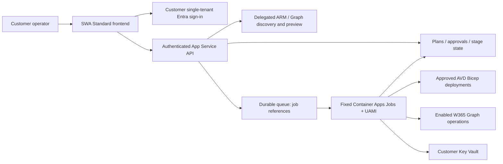

# V2: Self-hosted desktop deployment portal

Status: agreed design; Phase 1 CLI with Azure Preview/Deploy ready for a first sandbox run ([runbook](docs/sandbox-test.md)). No portal is implemented. Updated: 2026-10-14.

Customers install this portal into **their own Azure subscription and Entra tenant**, from this repository using Bicep and one bootstrap script. The author's instance is simply the first installation. There is no central service, cross-tenant access or vendor standing access. Future SaaS must receive a separate design; MVP contracts only keep the target tenant explicit.

## Design documents

- [Permission matrix](docs/permission-matrix.md): executing identities, Azure scopes, verified Graph permissions and gaps.
- [Threat model](docs/threat-model.md): STRIDE threats, mitigations and test ideas.
- [Customer bootstrap/uninstall](docs/bootstrap.md): customer-admin actions, privilege hand-offs and ownership-aware cleanup.
- [Delivery phases](docs/phases.md): Phase 1 contract/orchestration/CLI, exit criteria and pre-code questions.
- [Deployment experience](docs/deployment-experience.md): guided pilot defaults and the few choices operators should make.
- [Sandbox test runbook](docs/sandbox-test.md): prerequisites and step-by-step Preview/Deploy for a first real run.
- [Earlier project brief](PROJECT-BRIEF.md): superseded historical draft, not current requirements.
- [Phase 1 CLI](avd.ps1), [JSON Schema](contracts/avd-config.schema.json), [example config](config/avd.example.json), and isolated [AVD Bicep](infra/avd/platform.bicep) / [session-host Bicep](infra/avd/session-hosts.bicep).
- [ADR 0009](docs/adr/0009-native-avd-autoscale.md): optional host-pool scaling using the native AVD scaling plan.
- [ADR 0010](docs/adr/0010-persona-based-sizing.md): shared/dedicated, persona and user-count questions that size the host pool, using the [sizing profiles](contracts/sizing-profiles.json) and [sizing module](lib/AvdSizing.psm1).
- [ADR 0011](docs/adr/0011-user-profiles.md): FSLogix on Azure Files for shared pools (hybrid, or cloud-only preview) and local profiles for dedicated hosts, with the V2 [session host prep script](scripts/session-host-prep.ps1).
- [ADR 0012](docs/adr/0012-expansion-and-dedicated-users.md): expanding V2 deployments and assigning dedicated hosts to named users ([expansion module](lib/AvdExpansion.psm1)).
- [ADR 0013](docs/adr/0013-foundation-stage.md): subscription selection and Azure discovery in `New`, plus the foundation stage that creates the resource group, network with NAT, Key Vault with generated password, and deployment identity ([discovery module](lib/AvdDiscovery.psm1), [foundation Bicep](infra/avd/foundation.bicep)).
- [ADR 0014](docs/adr/0014-local-web-wizard.md): `-Mode Web`, a local browser wizard with dropdowns and a group picker that writes the same configuration ([page](web/index.html)).
- [ADR 0015](docs/adr/0015-post-deploy-configuration.md): display names users see, FSLogix sign-in protection, and `-Mode PostDeploy` for the Entra RDP setting, storage app consent/tag/private-link names, Conditional Access exclusion and FSLogix folder permissions ([post-deploy module](lib/AvdPostDeploy.psm1)).

## Phase 1 local CLI

The CLI covers a sizing questionnaire, expansion of saved V2 configurations, contract validation, Bicep compilation, and Azure **Preview** and **Deploy**. Follow the [sandbox test runbook](docs/sandbox-test.md) for a first real run.

```powershell
pwsh -NoProfile -File ./v2/avd.ps1 -Mode Web
pwsh -NoProfile -File ./v2/avd.ps1 -Mode New -OutputFile ./my-avd.json
pwsh -NoProfile -File ./v2/avd.ps1 -Mode Expand -ConfigurationFile ./my-avd.json -AddHosts 2
pwsh -NoProfile -File ./v2/avd.ps1 -Mode AddUser -ConfigurationFile ./my-avd.json -UserPrincipalName jane@contoso.com
pwsh -NoProfile -File ./v2/avd.ps1 -Mode Validate -ConfigurationFile ./v2/config/avd.example.json
pwsh -NoProfile -File ./v2/avd.ps1 -Mode Build -ConfigurationFile ./v2/config/avd.example.json
pwsh -NoProfile -File ./v2/avd.ps1 -Mode Preview -ConfigurationFile ./my-avd.json
pwsh -NoProfile -File ./v2/avd.ps1 -Mode Deploy -ConfigurationFile ./my-avd.json -AsSignedInUser -PostDeploy
pwsh -NoProfile -File ./v2/avd.ps1 -Mode PostDeploy -ConfigurationFile ./my-avd.json
pwsh -NoProfile -File ./v2/tests/Phase1.Tests.ps1
pwsh -NoProfile -File ./v2/tests/Deployment.Tests.ps1
pwsh -NoProfile -File ./v2/tests/Web.Tests.ps1
```

`-Mode Web` opens a local browser wizard ([ADR 0014](docs/adr/0014-local-web-wizard.md)). It uses your Azure sign-in and offers:

- subscription, region, time zone and working-hours dropdowns;
- new or existing VNet;
- a searchable group picker, or create-new;
- a live sizing recommendation, with a check that the VM size is available to your subscription in the region (and same-vCPU alternatives if it isn't);
- **Run Preview** in the page once the configuration is created.

It writes the same configuration as `-Mode New` (default `v2/sandbox/avd.json`). After Preview passes it shows the Deploy command, which you run in PowerShell. Use `-Port` or `-OutputFile` to change the defaults. In the terminal, `-Mode New -VmSize <size>` overrides the recommended size the same way.

The sample uses reserved/example values and is not deployable. The schema is the machine contract, not the intended questionnaire: the [guided pilot experience](docs/deployment-experience.md) derives ordinary values and keeps secret URIs/artifact digests out of the user flow. The target resource group and VNet/subnets must already exist for the current build-only slice. `Build` compiles the two V2 AVD entry points without Azure login or resource changes.

### Sizing questionnaire

`-Mode New` signs in to Azure and asks for the subscription, AVD region, prefix, resource group, new or existing VNet, and the users and admins groups by name. It then asks:

1. Is this a shared platform or dedicated session hosts?
2. Which persona: Frontline (web/LOB apps), Standard (Microsoft 365 and Teams) or Heavy?
3. How many users, and for shared pools, what peak concurrency?
4. For shared pools, are users hybrid (synced from AD) or cloud-only (preview)? This chooses the FSLogix profile.
5. Business-hours scaling or always available?
6. The workspace and desktop names users see, and for shared pools whether a failed profile load gives a temporary profile or blocks sign-in.

It writes `-OutputFile` as contract `1.5.0`:

- **Discovered or generated values:** tenant, subscription and target; network; AVD service principal; unique Key Vault and storage names; the deployment identity; and the pinned prep script ([artifacts.json](contracts/artifacts.json)).
- **A `foundation` section** that Deploy creates first ([ADR 0013](docs/adr/0013-foundation-stage.md)).
- **Sizing and scaling:** `profile`, `workload`, `hostPool`, `sessionHosts` and `scaling`.
- **What users see and FSLogix behaviour:** `display` and `fslogix` ([ADR 0015](docs/adr/0015-post-deploy-configuration.md)).

Every answer can be passed as a parameter for unattended use, for example `-SubscriptionId`, `-Location`, `-Prefix`, `-ResourceGroupName`, `-NetworkMode`, `-AddressSpace`, `-UsersGroup`, `-AdminsGroup`, `-Hosting`, `-Persona`, `-Users`, `-PeakConcurrencyPct`, `-UserIdentity`, `-ScalingPreset`, `-VmSize`, `-WorkspaceName`, `-DesktopName` and `-ProfileFailureAction`. Existing files need `-Force`. `-Offline` skips discovery and applies the sizing answers to a base configuration (`-ConfigurationFile`, by default the example).

- **Shared:** a pooled multi-session pool sized at Microsoft's users-per-vCPU guidance on D8s_v5 hosts, plus one spare. FSLogix profiles on Azure Files with Microsoft Entra Kerberos.
- **Dedicated:** a personal pool with one persona-sized single-session VM per user, Direct assignment, and the profile kept on the VM like Windows 365. No storage account is deployed.

`Validate` reports whether the configured hosts match the recommendation or are an override. Figures are starting estimates; see [ADR 0010](docs/adr/0010-persona-based-sizing.md).

### Expanding a V2 deployment

These modes update the saved configuration of an estate deployed by V2, in place or to `-OutputFile`. Nothing is written to Azure or Entra until the approved deploy.

- **`-Mode Expand`** (shared pools): `-AddHosts N`, or `-Users N` to re-size from the recorded persona. New hosts continue the stable names. VM size and sessions per host never change, and the host count never goes down.
- **`-Mode AddUser`** (dedicated pools): `-UserPrincipalName` gives the user the next free host, or adds one.
  - The UPN is resolved to an object ID with a read-only, delegated Graph lookup. Run `Connect-MgGraph -TenantId <tenant> -Scopes User.ReadBasic.All` first; sessions for other tenants are rejected. Alternatively pass `-UserObjectId`.
  - At deploy, the host's assigned user is set and the user is added to the AVD users group with the operator's own delegated permission.

See [ADR 0012](docs/adr/0012-expansion-and-dedicated-users.md).

### Profiles (FSLogix)

| Profile | Use | Status |
| --- | --- | --- |
| `AzureFilesHybridKerberos` | Shared pools, hybrid identities | Generally available |
| `AzureFilesEntraKerberosCloudOnly` | Shared pools, cloud-only Entra identities; needs `storage.acknowledgePreview: true` and admin prerequisites | Microsoft preview |
| `LocalProfile` | Dedicated pools; no FSLogix or storage | Not applicable |

See [ADR 0011](docs/adr/0011-user-profiles.md).

### Scaling

Contract `1.1.0` adds an optional `scaling` section. When present, the platform Bicep deploys a native AVD scaling plan (`<prefix>-ScalingPlan`) with one or more non-overlapping weekly schedules, each with ramp-up, peak, ramp-down and off-peak phases.

- **Pooled pools:** schedules set minimum host percentages, capacity thresholds, load balancing and user notification. The business-hours preset keeps at least one host on and, during working hours, keeps one empty host ready until every host is running. Users are spread breadth-first, and hosts with active or disconnected sessions are never shut down ([ADR 0009](docs/adr/0009-native-avd-autoscale.md#business-hours-preset-behaviour)).
- **Personal pools:** schedules set Start VM on Connect and deallocate-after-disconnect or after-logoff timers. Hibernate is excluded because of FSLogix.

The AVD service starts and deallocates existing hosts within `sessionHosts.count`. Nothing is created or deleted. `Validate` checks the time zone ID, phase ordering and day overlap. Omit `scaling` to keep the earlier behaviour; `1.0.0` files remain valid.

Before scaling can work, **Desktop Virtualization Power On Off Contributor** must be assigned to the Azure Virtual Desktop service principal **at subscription scope**. Deploy's foundation stage grants it when it is missing; otherwise Preview blocks until an Azure access administrator assigns it. See [ADR 0009](docs/adr/0009-native-avd-autoscale.md).

### Preview and Deploy

Both run in the [orchestration module](lib/AvdDeployment.psm1).

**`-Mode Preview`** is read-only:

- Signs in to the configured tenant and subscription if needed.
- Checks resource providers, the resource group, the VNet and subnets (unless the foundation creates them), Key Vault and storage name availability, the prep script SHA-256 and the autoscale power role.
- Runs Azure what-if: foundation at subscription scope; platform and session hosts once their resource group, network and host pool exist.
- Writes a plan (`<config>.plan.json`) bound to the configuration and template hashes, valid for 24 hours, with any blockers and warnings.

**`-Mode Deploy`** applies a fresh, blocker-free, unchanged plan:

- Approval is by typing the resource group name, or `-Approve <rg>`.
- It runs as the deployment managed identity, or as you with `-AsSignedInUser` for sandbox and local runs.
- It registers missing providers, then runs the **foundation**: resource group, VNet with NAT gateway, Key Vault with a generated admin password that is never shown or rotated, and the managed identity.
- It then deploys the platform and sets the desktop name users see, creates a 4-hour registration token, deploys hosts, **always revokes the token**, verifies registration, and restarts new FSLogix hosts once so the Kerberos setting applies.
- For dedicated pools it assigns hosts to named users and adds them to the AVD users group with your delegated Graph permission. Denial becomes a manual task, never a fallback.
- With `-PostDeploy` it then runs the post-deployment configuration below.
- It ends with the remaining manual tasks.

**`-Mode PostDeploy`** (also `Deploy -PostDeploy`) finishes the tenant and storage setup with your delegated rights ([ADR 0015](docs/adr/0015-post-deploy-configuration.md)):

- enables Microsoft Entra authentication for RDP (Windows Cloud Login), which the hosts' single sign-on needs;
- grants admin consent to the storage account's Entra app, adds the cloud-group tag (cloud-only) and its `privatelink` identifier URIs;
- excludes only that app from MFA Conditional Access policies that target all resources, after you confirm (`-ConditionalAccess Ask|Exclude|Report`); Microsoft-managed and device or privileged-role policies are listed for review;
- sets FSLogix's recommended folder permissions, briefly allowing only your public IP (`-OperatorPublicIp` or detected) through the storage firewall with a temporary data role, both always reverted;
- reports each host's Entra join, Intune management and Windows build.

Offline mocked tests cover ordering, failure handling and secret hygiene. The first real run should follow the [sandbox runbook](docs/sandbox-test.md). Do not use the root runner as a substitute.

## Locked decisions

| Decision | Agreed design | Record |
| --- | --- | --- |
| Distribution | Self-hosted, one installation per customer tenant, repo/Bicep/single bootstrap; no vendor access | [ADR 0001](docs/adr/0001-self-hosted-distribution.md) |
| Sign-in | Microsoft Entra ID only; customer-owned single-tenant SPA/API registrations created during bootstrap | [ADR 0002](docs/adr/0002-entra-sign-in.md) |
| Authorisation | Group-assigned `Portal.Reader`, `Portal.Operator`, `Portal.Approver`, `Portal.Admin`; every API request checked | [ADR 0003](docs/adr/0003-group-assigned-app-roles.md) |
| Hosting | SWA Standard frontend, separate authenticated API, isolated queued worker and persistent job state | [ADR 0004](docs/adr/0004-hosting-and-workers.md) |
| Execution | Operators' delegated discovery/preview; approved jobs use scoped customer UAMIs with feature-specific Graph grants | [ADR 0005](docs/adr/0005-execution-identities.md) |
| Products | AVD first; Windows 365 Enterprise next, Entra join/Microsoft-hosted network; verify licences only | [ADR 0006](docs/adr/0006-provider-scope.md) |
| Cloudflare | Out of scope for the MVP | [ADR 0007](docs/adr/0007-no-cloudflare.md) |
| Compatibility | All new work under `v2/`; root scripts/templates/tests stay untouched | [ADR 0008](docs/adr/0008-isolate-v2.md) |
| Scaling | Optional native AVD scaling plan (power management only); subscription-scope power role is a customer prerequisite | [ADR 0009](docs/adr/0009-native-avd-autoscale.md) |
| Sizing | Shared (pooled) or dedicated (personal) pools sized from persona and user count using Microsoft guidance; operator may override | [ADR 0010](docs/adr/0010-persona-based-sizing.md) |
| Profiles | FSLogix on Azure Files for shared pools (hybrid GA, cloud-only preview); local profiles on dedicated hosts | [ADR 0011](docs/adr/0011-user-profiles.md) |
| Expansion | Expand V2 estates from the saved config; dedicated hosts for named users; group membership via operator's delegated rights only | [ADR 0012](docs/adr/0012-expansion-and-dedicated-users.md) |
| Foundation | `New` discovers subscription/region/network/groups; Deploy creates the resource group, VNet with NAT, Key Vault with generated password and managed identity | [ADR 0013](docs/adr/0013-foundation-stage.md) |

## Architecture

Use **Azure Static Web Apps Standard**, required for a [bring-your-own backend](https://learn.microsoft.com/en-us/azure/static-web-apps/apis-overview). Link an App Service API through `/api`. Linking permits only proxied traffic by default, but the API must independently validate customer Entra API-audience tokens, delegated scope, app roles and target policy. SWA identity headers or invite roles are not the API authority. Use MSAL/PKCE and API OBO for downstream delegated tokens, never worker-powered discovery.

The recommendation is **event-driven Azure Container Apps Jobs**, rather than Durable Functions, to preserve pinned PowerShell/Bicep tooling and isolate each execution. Durable Functions supports PowerShell and offers durable timers/checkpoints; the tradeoff is function/activity decomposition and replay constraints. Container jobs require explicit state/recovery and are not themselves a durable workflow engine. See ADR 0004 for the comparison and security constraints.

Persist plans/approvals/stages in Table Storage, work references in Storage Queue, reviewed images in customer ACR, secrets in Key Vault and sanitised reports in restricted Blob Storage. Keep portal and workload RGs separate. App Service's operational UAMI has no workload mutation/job-start grant. Separate AVD/W365 mutation and observation identities; bootstrap privileges never become runtime grants.



SWA linked APIs have a 45-second request limit, do not support network-isolated backends or pull-request environments, and serve only HTTP APIs. Split preview submission/polling into short authenticated requests; delegated token acquisition stays user-scoped, not in deployment queue payloads. API bearer forwarding/OBO plus the linked-origin guard requires a later integration test. No auth-disable fallback is allowed.

## Behaviour and scope

1. Operator signs in to the installed tenant, chooses an authorised target/profile and discovers resources using their own delegated permissions.
2. Validate/import/export versioned non-secret settings; show prerequisite blockers, permission requirements, costs and manual tasks.
3. Generate ARM what-if or a separate Graph desired/current plan. No resource creation, token rotation or licence mutation during preview.
4. Approver approves exact tenant, scope, actor, configuration/artifact hashes, expiry and affected resources/groups. Material change requires reapproval.
5. Submit durable work; worker validates the approval and executes allowlisted provider stages with scoped UAMI authority. Closing the browser does not lose accepted work.
6. Report stages, operation/resource IDs and manual readiness checks. A provider-accepted operation is not proof of user/device readiness.

AVD preserves the [current runner](../Deploy-AvdSolution.ps1), [Bicep behaviour](../main.bicep) and [documented boundaries](../README.md): platform then hosts, incremental reruns, stable zero-based host names, four-hour registration token/revocation and registration checks. Fresh Azure host preflight requires the pool/RG to exist. Reducing a count does not drain/delete; failures do not delete successfully deployed infrastructure. Day-to-day capacity is handled by the optional AVD scaling plan, which powers existing hosts on and off but never removes them.

Existing networks/groups, Azure Files Microsoft Entra Kerberos consent (hybrid, or cloud-only preview prerequisites per [ADR 0011](docs/adr/0011-user-profiles.md)), Windows ACLs, DNS forwarding, Intune prerequisites and real sign-in/profile-persistence verification remain explicit administrator tasks. Pin V2 scripts/tooling/image versions; do not import broad legacy Conditional Access changes or arbitrary preparation URLs.

Windows 365 Enterprise uses Graph policies/group assignments, not Bicep session-host VMs. Entra join/Microsoft-hosted networking and gallery images only. Verify tenant/user licences; never assign/buy them. Groups and licences can drift after approval, so require fresh evidence and pause stale jobs. Full provisioning-status observation is a verified-capability gate, not an assumed v1.0 property.

No MVP Windows Forms/agent, central SaaS, cross-tenant credentials, Cloudflare, licence mutation, arbitrary Graph/shell proxy, broad Intune policy management, automatic legacy adoption or destructive lifecycle operations.

## Security and verification

API roles do not grant Azure RBAC or Graph rights. Default ARM what-if needs deployment permissions despite not modifying resources; reduced-permission `ProviderNoRbac` preview still needs tested residual deployment actions. Never substitute worker credentials after a delegated denial.

Group app-role assignment needs Entra ID P1/P2 and direct membership. PRA/GA grants Microsoft Graph application roles during feature enablement; Azure access administrators separately grant scoped resource permissions. AVD-only defaults require no worker Graph application grants. W365 mutation permission is tenant-wide in effect even if portal targets are narrow.

The [matrix](docs/permission-matrix.md) records current Learn sources and explicit gaps: newest app/group least-permission entries, exact Azure custom-role/condition minima, app-only licence-detail limitations and v1.0 lifecycle-status coverage. Those are implementation gates, not permission to guess or silently use beta. No live Azure/Graph checks were run for this design.

## Decisions still open

- First sandbox inputs and customer owners for hybrid identity, network/DNS and file ACL prerequisites.
- Target RG creation and constrained RBAC-assignment strategy; exact grants must pass scope tests.
- Versioned contract/import format, secret-reference sources and pinned artifact distribution for Phase 1.
- Approval/self-approval rules, freshness/expiry and concurrency/host limits for the first installation.
- Before portal install: implementation versions, region/SKUs/budget, retention/residency, OBO certificate lifecycle and API exposure constraints.

Proceed only when the relevant [phase gate](docs/phases.md) is approved. The CLI's Preview signs in to Azure read-only. Deploy creates resources and, for dedicated users, changes group membership, and should first be run in a sandbox. No bootstrap, app registration or Graph consent automation is included.
