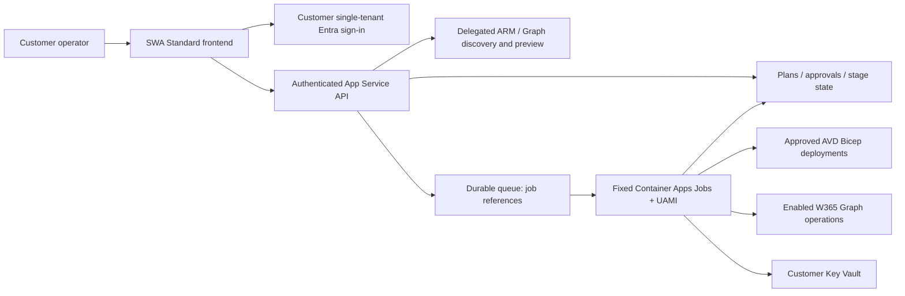

# V2: Self-hosted desktop deployment portal

Status: agreed design; Phase 1 local contract/CLI/build slice in progress. No portal or Azure deployment is implemented or approved. Updated: 2026-10-11.

Customers install this portal into **their own Azure subscription and Entra tenant**, from this repository using Bicep and one bootstrap script. The author's instance is simply the first installation. There is no central service, cross-tenant access or vendor standing access. Future SaaS must receive a separate design; MVP contracts only keep the target tenant explicit.

## Design documents

- [Permission matrix](docs/permission-matrix.md): executing identities, Azure scopes, verified Graph permissions and gaps.
- [Threat model](docs/threat-model.md): STRIDE threats, mitigations and test ideas.
- [Customer bootstrap/uninstall](docs/bootstrap.md): customer-admin actions, privilege hand-offs and ownership-aware cleanup.
- [Delivery phases](docs/phases.md): Phase 1 contract/orchestration/CLI, exit criteria and pre-code questions.
- [Deployment experience](docs/deployment-experience.md): guided pilot defaults and the few choices operators should make.
- [Earlier project brief](PROJECT-BRIEF.md): superseded historical draft, not current requirements.
- [Phase 1 CLI](avd.ps1), [JSON Schema](contracts/avd-config.schema.json), [example config](config/avd.example.json), and isolated [AVD Bicep](infra/avd/platform.bicep) / [session-host Bicep](infra/avd/session-hosts.bicep).

## Phase 1 local CLI

The current offline slice supports contract validation and Bicep compilation only:

```powershell
pwsh -NoProfile -File ./v2/avd.ps1 -Mode Validate -ConfigurationFile ./v2/config/avd.example.json
pwsh -NoProfile -File ./v2/avd.ps1 -Mode Build -ConfigurationFile ./v2/config/avd.example.json
pwsh -NoProfile -File ./v2/tests/Phase1.Tests.ps1
```

The sample uses reserved/example values and is not deployable. The schema is the machine contract, not the intended questionnaire: the [guided pilot experience](docs/deployment-experience.md) derives ordinary values and keeps secret URIs/artifact digests out of the user flow. The target resource group and VNet/subnets must already exist for the current build-only slice. `Build` compiles the two V2 AVD entry points without Azure login or resource changes. Azure `Preview` and `Deploy` are deliberately not exposed yet: delegated preview, approved-plan binding, UAMI execution, artifact digest verification and failure/token-cleanup orchestration still need implementation and sandbox approval. Do not use the root runner as a substitute.

## Locked decisions

| Decision | Agreed design | Record |
| --- | --- | --- |
| Distribution | Self-hosted, one installation per customer tenant, repo/Bicep/single bootstrap; no vendor access | [ADR 0001](docs/adr/0001-self-hosted-distribution.md) |
| Sign-in | Microsoft Entra ID only; customer-owned single-tenant SPA/API registrations created during bootstrap | [ADR 0002](docs/adr/0002-entra-sign-in.md) |
| Authorisation | Group-assigned `Portal.Reader`, `Portal.Operator`, `Portal.Approver`, `Portal.Admin`; every API request checked | [ADR 0003](docs/adr/0003-group-assigned-app-roles.md) |
| Hosting | SWA Standard frontend, separate authenticated API, isolated queued worker and persistent job state | [ADR 0004](docs/adr/0004-hosting-and-workers.md) |
| Execution | Operators' delegated discovery/preview; approved jobs use scoped customer UAMIs with feature-specific Graph grants | [ADR 0005](docs/adr/0005-execution-identities.md) |
| Products | AVD first; Windows 365 Enterprise next, Entra join/Microsoft-hosted network; verify licences only | [ADR 0006](docs/adr/0006-provider-scope.md) |
| Cloudflare | Out of scope for the MVP | [ADR 0007](docs/adr/0007-no-cloudflare.md) |
| Compatibility | All new work under `v2/`; root scripts/templates/tests stay untouched | [ADR 0008](docs/adr/0008-isolate-v2.md) |

## Architecture

Use **Azure Static Web Apps Standard**, required for a [bring-your-own backend](https://learn.microsoft.com/en-us/azure/static-web-apps/apis-overview). Link an App Service API through `/api`. Linking permits only proxied traffic by default, but the API must independently validate customer Entra API-audience tokens, delegated scope, app roles and target policy. SWA identity headers or invite roles are not the API authority. Use MSAL/PKCE and API OBO for downstream delegated tokens, never worker-powered discovery.

The recommendation is **event-driven Azure Container Apps Jobs**, rather than Durable Functions, to preserve pinned PowerShell/Bicep tooling and isolate each execution. Durable Functions supports PowerShell and offers durable timers/checkpoints; the tradeoff is function/activity decomposition and replay constraints. Container jobs require explicit state/recovery and are not themselves a durable workflow engine. See ADR 0004 for the comparison and security constraints.

Persist plans/approvals/stages in Table Storage, work references in Storage Queue, reviewed images in customer ACR, secrets in Key Vault and sanitised reports in restricted Blob Storage. Keep portal and workload RGs separate. App Service's operational UAMI has no workload mutation/job-start grant. Separate AVD/W365 mutation and observation identities; bootstrap privileges never become runtime grants.



SWA linked APIs have a 45-second request limit, do not support network-isolated backends or pull-request environments, and serve only HTTP APIs. Split preview submission/polling into short authenticated requests; delegated token acquisition stays user-scoped, not in deployment queue payloads. API bearer forwarding/OBO plus the linked-origin guard requires a later integration test. No auth-disable fallback is allowed.

## Behaviour and scope

1. Operator signs in to the installed tenant, chooses an authorised target/profile and discovers resources using their own delegated permissions.
2. Validate/import/export versioned non-secret settings; show prerequisite blockers, permission requirements, costs and manual tasks.
3. Generate ARM what-if or a separate Graph desired/current plan. No resource creation, token rotation or licence mutation during preview.
4. Approver approves exact tenant, scope, actor, configuration/artifact hashes, expiry and affected resources/groups. Material change requires reapproval.
5. Submit durable work; worker validates the approval and executes allowlisted provider stages with scoped UAMI authority. Closing the browser does not lose accepted work.
6. Report stages, operation/resource IDs and manual readiness checks. A provider-accepted operation is not proof of user/device readiness.

AVD preserves the [current runner](../Deploy-AvdSolution.ps1), [Bicep behaviour](../main.bicep) and [documented boundaries](../README.md): platform then hosts, incremental reruns, stable zero-based host names, four-hour registration token/revocation and registration checks. Fresh Azure host preflight requires the pool/RG to exist. Reducing a count does not drain/delete; failures do not delete successfully deployed infrastructure.

Existing networks/groups, Azure Files hybrid Kerberos consent, Windows ACLs, DNS forwarding, Intune prerequisites and real sign-in/profile-persistence verification remain explicit administrator tasks. Pin V2 scripts/tooling/image versions; do not import broad legacy Conditional Access changes or arbitrary preparation URLs.

Windows 365 Enterprise uses Graph policies/group assignments, not Bicep session-host VMs. Entra join/Microsoft-hosted networking and gallery images only. Verify tenant/user licences; never assign/buy them. Groups and licences can drift after approval, so require fresh evidence and pause stale jobs. Full provisioning-status observation is a verified-capability gate, not an assumed v1.0 property.

No MVP Windows Forms/agent, central SaaS, cross-tenant credentials, Cloudflare, licence mutation, arbitrary Graph/shell proxy, broad Intune policy management, automatic legacy adoption or destructive lifecycle operations.

## Security and verification

API roles do not grant Azure RBAC or Graph rights. Default ARM what-if needs deployment permissions despite not modifying resources; reduced-permission `ProviderNoRbac` preview still needs tested residual deployment actions. Never substitute worker credentials after a delegated denial.

Group app-role assignment needs Entra ID P1/P2 and direct membership. PRA/GA grants Microsoft Graph application roles during feature enablement; Azure access administrators separately grant scoped resource permissions. AVD-only defaults require no worker Graph application grants. W365 mutation permission is tenant-wide in effect even if portal targets are narrow.

The [matrix](docs/permission-matrix.md) records current Learn sources and explicit gaps: newest app/group least-permission entries, exact Azure custom-role/condition minima, app-only licence-detail limitations and v1.0 lifecycle-status coverage. Those are implementation gates, not permission to guess or silently use beta. No live Azure/Graph checks were run for this design.

## Decisions still open

- First sandbox inputs and customer owners for hybrid identity, network/DNS and file ACL prerequisites.
- Target RG creation and constrained RBAC-assignment strategy; exact grants must pass scope tests.
- Versioned contract/import format, secret-reference sources and pinned artifact distribution for Phase 1.
- Approval/self-approval rules, freshness/expiry and concurrency/host limits for the first installation.
- Before portal install: implementation versions, region/SKUs/budget, retention/residency, OBO certificate lifecycle and API exposure constraints.

Proceed only when the relevant [phase gate](docs/phases.md) is approved. The current CLI does not authenticate to Azure or deploy resources; no bootstrap, app registration, Graph consent or tenant change is included.
